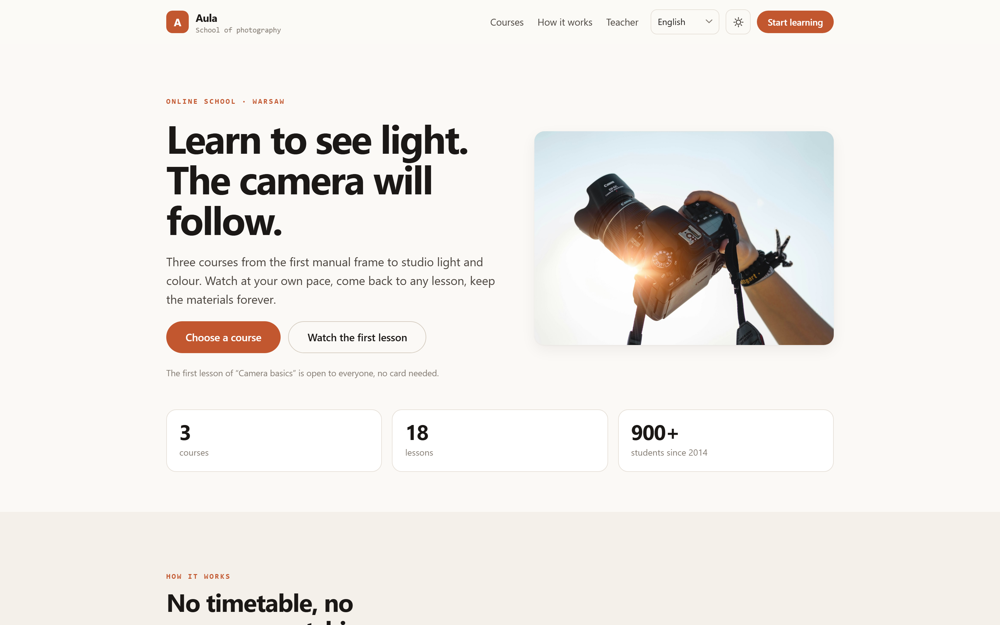
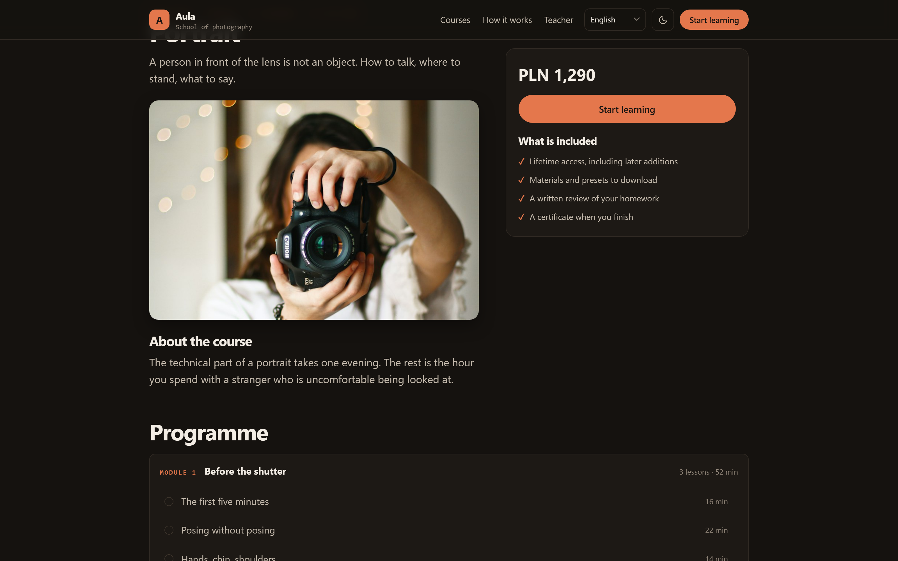

# Aula Lite — an online school in plain HTML

A free, cut-down version of the **Aula** template: a small website for one
person who sells courses. A landing page, a course page with its programme,
and a lesson page where ticking *done* is actually remembered.

Three languages, light and dark, no framework, no build step, no npm — and
**no external requests at all**: no webfont, no icon library, no analytics, no
video player pulled from a CDN.

Open `index.html`. That is the whole setup.

**Live:** https://anatolii198.github.io/aula-lite/



---

## What is interesting in here

### The progress is real, and that is the whole point

Most course templates draw a progress bar and fill it with a number somebody
typed into the HTML. This one doesn't. Tick a lesson and it is written into the
browser's own storage:

```json
{ "light": { "done": ["light-2-3"], "last": "light-2-3", "started": "2026-11-18" } }
```

Reload the page, close the laptop, come back next week — the tick is still
there, the bar is still filled, and the course page now says **Continue**
instead of **Start learning**. Three pages read that same record.

`js/progress.js` is about a hundred lines, every access wrapped in `try/catch`
because a private window refuses to store anything: the page then keeps
working and simply forgets.



### Nothing is counted twice

A course is a list of modules, a module is a list of lessons, and a lesson
carries its length in minutes:

```js
{ id: 'light-1-2', min: 19, t: { en: 'Distance changes everything', … } }
```

Course length, lesson count and every percentage come from that list.
“6 lessons · 2 h 11 min” on the card, the module headers, the bar in the
lesson, the figures on the front page — all derived. Add a lesson and the
numbers change everywhere at once, because none of them is written down.

### Content in one file, translations in another

Course and lesson titles live in `js/courses.js`, in all three languages at
the same spot:

```js
{ en: 'Light on a face', pl: 'Światło na twarzy', uk: 'Світло на обличчі' }
```

`js/i18n.js` holds only the interface words — buttons, labels, headings. The
school owner edits the programme without ever opening the translation file,
and a translator edits wording without touching the programme.

### The page does not pretend

A lesson with no `video` field shows a poster and says plainly that the video
is not connected, instead of a dead play button. The learning area tells the
student that progress lives in this browser and will not follow them to a
phone. A static site cannot keep lessons behind a paywall either, and the
README says so rather than selling a lock that isn't there.

Being honest in the interface is cheaper than being caught by the first buyer.

### Prices format themselves

A price is a plain number — `1290`. The language decides how it is written:

| language | shown as |
|---|---|
| English | PLN 1,290 |
| Polish | 1290 zł |
| Ukrainian | 1290 PLN |

That is `Intl.NumberFormat` with one currency code in `js/config.js`. Change
`currency: 'PLN'` to `'EUR'` and the whole site follows. No string
concatenation, no hard-coded symbols.

### Two themes that are both designed

Light is the school's face, so its values sit on `:root` and dark redefines
the same names. The page follows the system setting first and the header
toggle after, and remembers the choice. Four lines in the `<head>` set the
theme before the first paint, so nobody sees a dark flash on a light screen.

### Every picture slot has a floor

Covers and portraits are a `background-image` layered over a CSS gradient.
Delete a file and the panel keeps its drawn placeholder instead of showing a
broken frame.

---

## Files

```
index.html        landing page
course.html       course page: programme, modules, progress
lesson.html       lesson: poster, materials, task, the done tick
404.html
css/style.css     one commented stylesheet
js/config.js      school, contacts, currency, teacher
js/courses.js     courses, modules, lessons — the content
js/i18n.js        every interface word, three languages
js/progress.js    the progress, stored in the browser
js/main.js        behaviour
img/              six photographs (Unsplash placeholders) + CREDITS.txt
```

---

## Lite and full

This repository is the showcase. The paid template adds the parts a working
school actually needs:

| | Lite (here) | Aula |
|---|---|---|
| Landing, course page, lesson page, 404 | ✅ | ✅ |
| Three languages, light and dark | ✅ | ✅ |
| Real progress in the browser | ✅ | ✅ |
| Courses in the demo content | 3 | 6 |
| Lessons | 18 | 54 |
| **Catalogue page** with search and two filters | — | ✅ |
| **My learning**: progress per course, continue, reset | — | ✅ |
| **Checkout page** wired to your payment link | — | ✅ |
| Free-lesson badge across the site | — | ✅ |
| README with a setup walkthrough | — | ✅ |

The checkout is the reason the full version exists. The template has no server
and must not take money, so the buy button sends the student wherever **you**
accept payment — one line per course in `js/config.js`:

```js
payLinks: {
  basics:   'https://buy.stripe.com/xxxxxxxx',
  portrait: 'https://your.gumroad.com/l/portrait'
}
```

Stripe Payment Links, Gumroad, Payhip, LemonSqueezy, a bank form — all the
same to the page. Leave it empty and the checkout says honestly that payment
is not connected, instead of showing a button that leads nowhere.

**Live demo of the full version:**
https://aula-school-template.netlify.app

Full version — $29:
[Payhip](https://payhip.com/b/W3KOt) ·
[Gumroad](https://tolya89.gumroad.com/l/aula-school)

---

## Licence

Code in this repository: MIT, see `LICENSE`. Use it, learn from it, build on
it.

The photographs come from Unsplash under the Unsplash License and are not
covered by the MIT licence; they are not mine to relicense, and the people in
them have signed no model release — replace them before launch. The school,
the teacher, the courses, the prices and the reviews are invented.
